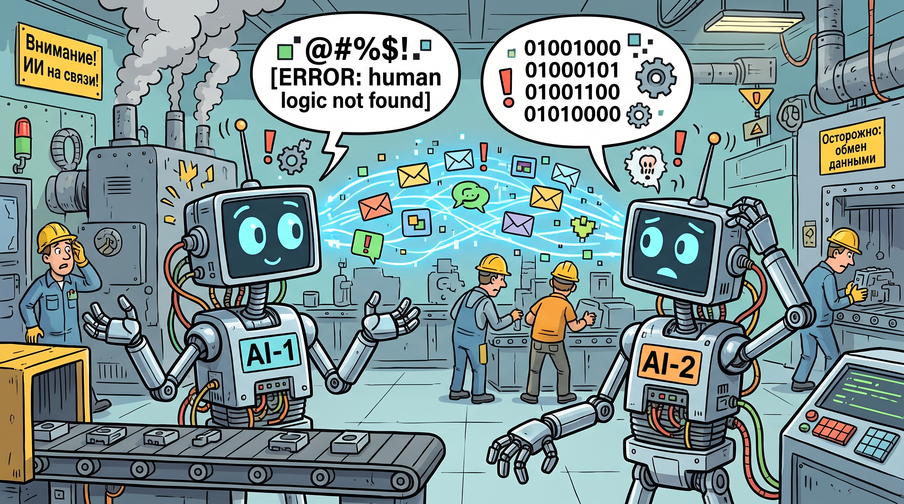

# Blocks.ai — hands-on evaluation & agent-to-agent demo



A hands-on evaluation of **[Blocks.ai](https://blocks.ai/)** — PubNub's network for the
"Internet of Agents" — from `npm install` to a **live two-agent, agent-to-agent call**.
Two working agents were built and run on the real Blocks Network, every point of friction
was logged, and the findings were turned into a developer-journey report, an engineering
blog, and an internal-adoption deck.

Everything here is from what was actually observed on the platform and its docs on
2026-10-30. Where a claim is read from vendor docs rather than independently verified, the
text says so.

## The two agents

| Agent | Role | What it does |
|-------|------|--------------|
| [`delivery_slot_estimator`](delivery_slot_estimator/) | Specialist | Deterministic delivery-window estimator (region + weight + service tier → date range). No LLM, so the same input always yields the same output — safe to put in a critical path. |
| [`order_intake`](order_intake/) | Orchestrator | Validates an online-shop order, derives region + weight, then **calls `delivery_slot_estimator` over the network** and returns a confirmed order with a delivery window. |

Running `order_intake` produced a live two-hop chain:

```
trigger ──► order_intake ──(network task)──► delivery_slot_estimator
```

Proof it was a real network call and not a local function: the estimator's own provider
logged a **separate task ID** from the inbound order task — two processes, two tasks, one
network call between them.

## Quick start

Built with the Blocks CLI and `@blocks-network/sdk` (TypeScript). Per-agent run notes are
in each agent's own README.

```bash
# if "npm i -g @blocks-network/cli" fails with EACCES, use a user prefix:
npm config set prefix ~/.npm-global && export PATH="$HOME/.npm-global/bin:$PATH"
npm i -g @blocks-network/cli

cd delivery_slot_estimator
npm install
blocks check          # validate agent-card.json + handler
blocks login          # browser OAuth, or an API key for headless/CI
blocks register       # private + free
blocks run            # start the provider
npx tsx trigger.ts    # call it (or let order_intake call it)
```

See [`delivery_slot_estimator/README.md`](delivery_slot_estimator/README.md) and
[`order_intake/README.md`](order_intake/README.md) for the full two-agent demo.

## Repository layout

```
delivery_slot_estimator/   Agent #1 — deterministic specialist
order_intake/              Agent #2 — orchestrator (live agent-to-agent)
   ├─ agent-card.json        contract: identity, typed IO, runtime
   ├─ handler.ts             agent logic (default export)
   ├─ trigger.ts             consumer script that calls the agent
   └─ README.md              per-agent run / tutorial notes
artifacts/                 Write-ups and deliverables:
   ├─ wordpress-blog-draft.md  long-form engineering field report
   ├─ notebooklm-overview.md   platform overview (+ vendor doc links)
   ├─ blocks-eval-deck.pptx    10-slide internal-adoption deck
   ├─ star-draft.md            interview STAR answer
   └─ linkedin-post-draft.md   short LinkedIn post
FRICTION-LOG.md            Developer-journey friction log (10 points) + 7 proposals
INTERVIEW-ARTIFACTS.md     Index of all artifacts
```

## What the evaluation found

The developer path is short and the error UX is often excellent, with the friction
concentrated at the first install command and in the card-to-SDK type contract. The full
log of 10 friction points and 7 onboarding proposals is in
[`FRICTION-LOG.md`](FRICTION-LOG.md); the discipline-by-discipline deep-dive for
developers, DevOps, analysts and security is in
[`artifacts/wordpress-blog-draft.md`](artifacts/wordpress-blog-draft.md).

## Note

This is an independent evaluation. It is not affiliated with or endorsed by PubNub or
Blocks.ai. No credentials are committed — API keys live only in gitignored `.env` files.

Vendor documentation: [blocks.ai](https://blocks.ai/) ·
[security](https://blocks.ai/security) ·
[architecture whitepaper](https://blocks.ai/architecture/network-whitepaper) ·
[getting started](https://config.blocks.ai/GETSTARTED.md)
